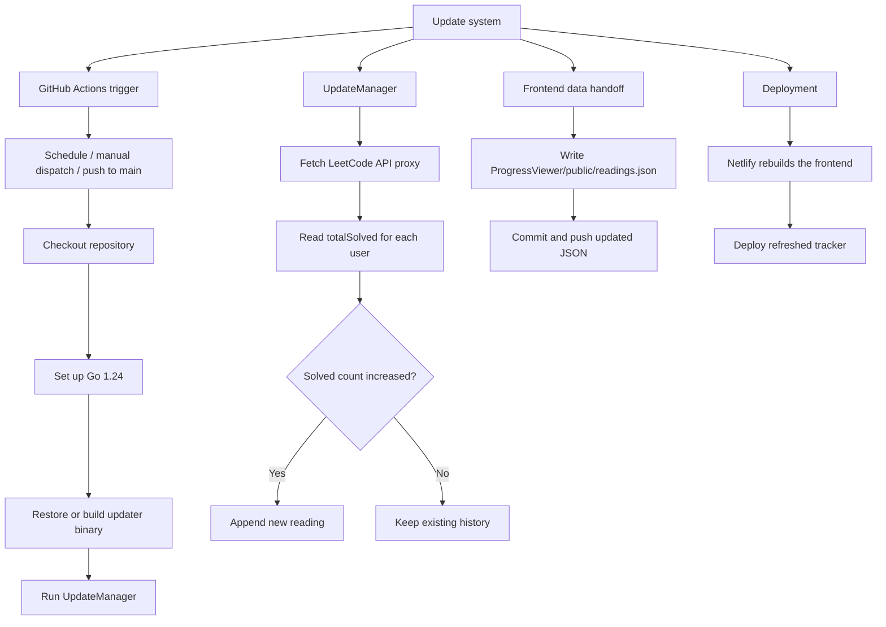

# Auto-Updating Leetcode Progress Tracker

This repository tracks LeetCode solve counts for a small set of accounts and turns them into a time-series dashboard. The important idea is that the site does not compute progress live in the browser. Instead, a GitHub Action periodically runs a Go updater, writes the newest readings into `ProgressViewer/public/readings.json`, commits that file back to the repository, and Netlify serves the site from that updated artifact.

The original use case was comparing progress with [Munis](https://github.com/muniss950), but the structure now supports tracking several friends at once.

## How it works

The repo has two moving parts:

1. `UpdateManager/` is the data collection side.
2. `ProgressViewer/` is the static UI that reads the generated JSON and renders charts.

The browser never talks directly to LeetCode. It only fetches `/readings.json`, which is the file produced by the updater.

### Update pipeline

1. `.github/workflows/update.yml` runs on a schedule, on manual dispatch, and on pushes to `main`.
2. The workflow checks out the repository and sets up Go 1.24, reusing cached Go state and a compiled updater when its sources have not changed.
3. It runs the Go command in `UpdateManager/` from the repository root.
4. The updater fetches each tracked user from the LeetCode API proxy, extracts `totalSolved`, compares it with the latest stored reading, and appends a new entry only when the count increases.
5. The updater loads and saves `ProgressViewer/public/readings.json`.
6. The workflow commits the updated JSON back to `main`.
7. Netlify rebuilds the site from the updated repository contents and serves the refreshed chart.



The repository currently deploys through Netlify, not GitHub Pages. If the hosting target changes later, the last two nodes in the diagram are the only ones that need to change.

### What the updater does

`UpdateManager/main.go` is the entry point. It loops over the configured usernames, fetches their data, retries transient failures with a bounded retry count, and waits between requests so the API is not hit too aggressively.

The Go updater uses the standard library for HTTP, JSON parsing, persistence, and timestamps. It requires a successful response containing `totalSolved` and returns a non-zero exit code after retry attempts are exhausted.

The readings file preserves existing key order and unknown keys. Missing files are initialized, while malformed or unreadable existing files are rejected without overwriting them. Successful writes replace the file atomically.

### What the UI does

`ProgressViewer/src/App.tsx` is the main React component. It fetches `/readings.json`, converts the stored `[solvedCount, timestamp]` pairs into chart points, and renders the line chart with controls for:

1. time-range filtering,
2. custom duration windows,
3. drag selection on the chart,
4. and optional delta lines between two users.

`ProgressViewer/src/main.tsx` only boots React, and `ProgressViewer/src/index.css` is just the styling entry point.

The UI is intentionally static. It becomes current only when the workflow updates `readings.json` and that file is redeployed.

## Local development

The project is not primarily designed as a local-first app, but you can still work on it locally:

1. Install dependencies in `ProgressViewer/` and run the Vite dev server for the UI.
2. Build and run the Go updater from the repository root if you want to refresh `readings.json` manually.

Typical commands:

```bash
cd ProgressViewer
npm install
npm run dev
```

```bash
go run ./UpdateManager
```

## Deployment

The deployed site is available at <https://battle.anga.codes>.

The deployment model is deliberately simple: the repository stores the historical readings, the workflow updates that history, and Netlify serves the built static app from the latest commit.

## Repository layout

- `ProgressViewer/public/readings.json`: generated history consumed by the UI.
- `ProgressViewer/src/App.tsx`: charting and interaction logic.
- `UpdateManager/main.go`: updater entry point, API client, and JSON persistence.
- `UpdateManager/main_test.go`: deterministic updater tests.
- `go.mod`: Go module definition.
- `.github/workflows/update.yml`: scheduled update job.
